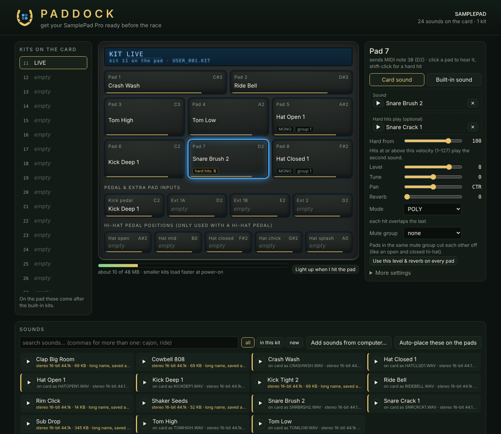

# PADDOCK

**get your SamplePad Pro ready before the race**

A kit builder for the **Alesis SamplePad Pro** that runs in your web browser. Building kits on the pad's little screen takes forever. PADDOCK shows the whole pad at once: drag sounds onto pads, click to hear them, set level, tune, pan and reverb, then press Save. The kit goes straight onto the pad's SD card.

**[▶ Open PADDOCK](https://daneguitarist.github.io/paddock/)** (Chrome or Edge on a computer) · or download it from [Releases](../../releases) and double-click `PADDOCK.html`. It works offline too.



## What it does

- **Any audio file in.** WAV, AIFF, MP3, FLAC, OGG, any bit depth or sample rate. PADDOCK turns it into what the pad plays (16-bit WAV at a rate it supports) and gives it a legal 8-character name.
- **Your long file names stay.** `CajonKick10.wav` goes onto the card as a short copy (`CJNKCK10.WAV`). The page keeps showing the long name, and your original is never renamed, changed or deleted.
- **Auto-place.** Search your sounds ("cajon") and press one button. Kicks, snares, hats, toms and cymbals land on sensible pads by their names. The open and closed hats cut each other off.
- **Faster power-on.** Trims dead silence off the ends and turns fake stereo into mono, so the sound is the same and the kit loads faster. A bar shows how much of the pad's 48 MB per kit you're using.
- **Everything the pad has:** two velocity layers, level, tune, pan, reverb, mode (POLY, MONO, LOOP, STOP, TMP, CLK), mute groups, MIDI notes, the kick pedal, the extra pad inputs and the five hi-hat pedal positions. Pads can also use the pad's built-in sounds.
- **Hit a pad, see it.** With the pad plugged in normally, "Light up when I hit the pad" highlights each pad in the page as you hit it.

## Using it

1. On the pad, hold **▲ + ◀** for 2 seconds, choose **Load Samples/Kits Via USB**, and press **▶**. The card shows up as a drive. (An SD card reader also works and is faster.)
2. Open PADDOCK, click **Open SamplePad card…** and pick that drive.
3. Pick a kit (they're numbered the way the pad shows them: the card's kits start at 11), build it, and press **Save to card**.
4. Leave USB mode (hold **◀ + ▲** for 2 seconds), pick the kit on the pad, and play.

**Getting to your live kit.** The pad always powers on into kit 1, and its own kits 1–10 can't be saved over (SAVE KIT and COPY KIT won't go there). The kits on the card come after them, from kit 11, so after power-on highlight the kit number and tap **▶** up to your kit: ten quick taps reach kit 11.

**Stop it switching itself off mid-set.** Hold **▲ + ◀** → **Other** → **Auto-Shutdown** → **Off**. Then hold **▼ + ▶** (the Save menu) → **SAVE GLOBAL SETTINGS** → **▶** → highlight **YES** → **▶**. Without the YES, the pad forgets it at power-off.

## Safety

- Opening the card changes nothing. PADDOCK writes only when you press Save, and the browser asks you first.
- Before the first save, every kit on the card is copied to `PADDOCK/backups/<date>/`.
- Each kit is read back after it's written and checked byte for byte.
- PADDOCK never overwrites or deletes your sound files and never touches the pad's firmware files. It only writes the same kind of files the pad writes itself.

## Not known yet

- **Sensitivity.** Kits store it as a raw number (kits the pad saves use 16), and how that maps to the pad's SENS 1–8 isn't known yet. PADDOCK keeps 16 unless you change it.
- **Built-in sound names.** The pad's built-in sound names live inside its update file. "Find all built-in sound names on the card" reads that file from the card and uses the list only if it matches every built-in sound your kits already use.
- **Other models.** This is made for the SamplePad Pro. The SampleRack and SamplePad 4 use different kit files.

If something doesn't work on your pad, [open an issue](../../issues) and say what the pad shows.

## Building from source

`PADDOCK.html` is one self-contained file put together from `src/`:

```
python3 build.py index.html
node test/roundtrip.js path/to/USER_001.KIT   # a kit the pad saved must come back byte for byte
node test/builtins_test.js
```

## Credits

The `.KIT` block layout was first worked out by [LesserChance's samplepad-editor](https://github.com/LesserChance/samplepad-editor) (CC BY 4.0), and checked here against kits saved by a SamplePad Pro. The code in this repository is new.

Not made by or affiliated with Alesis. SamplePad is a trademark of inMusic Brands.

Made by [GerbilHamster Records](https://gerbilhamsterrecords.com). MIT licence.
